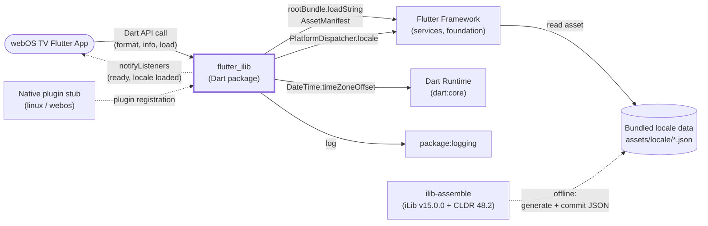
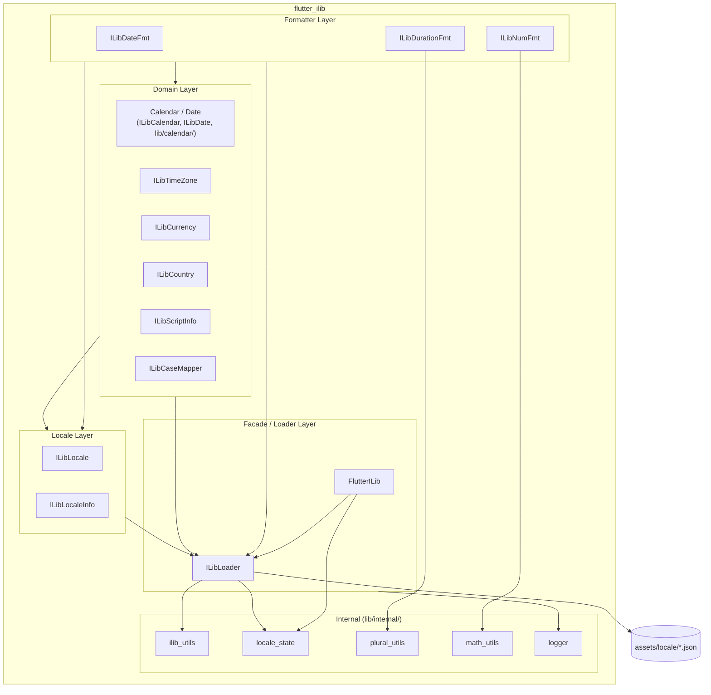
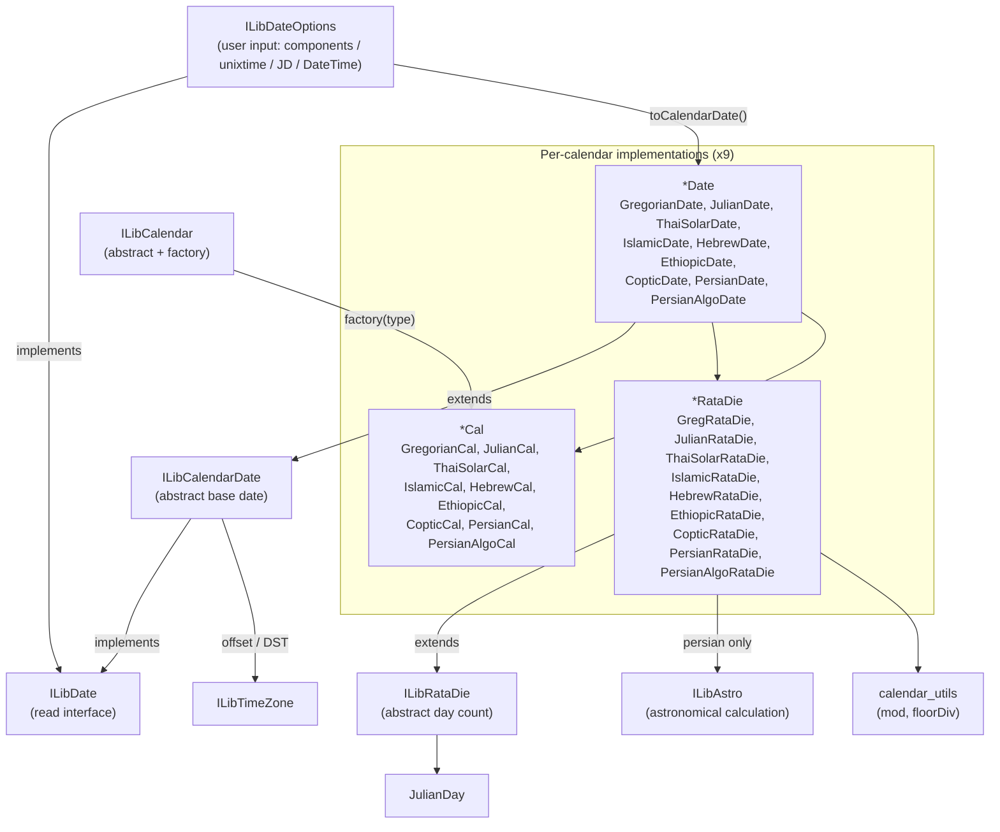
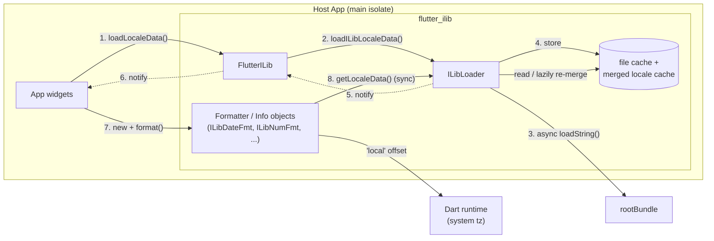
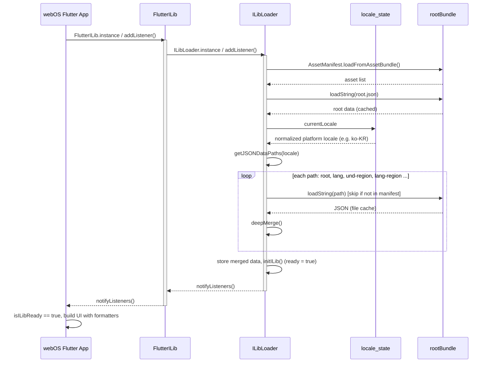
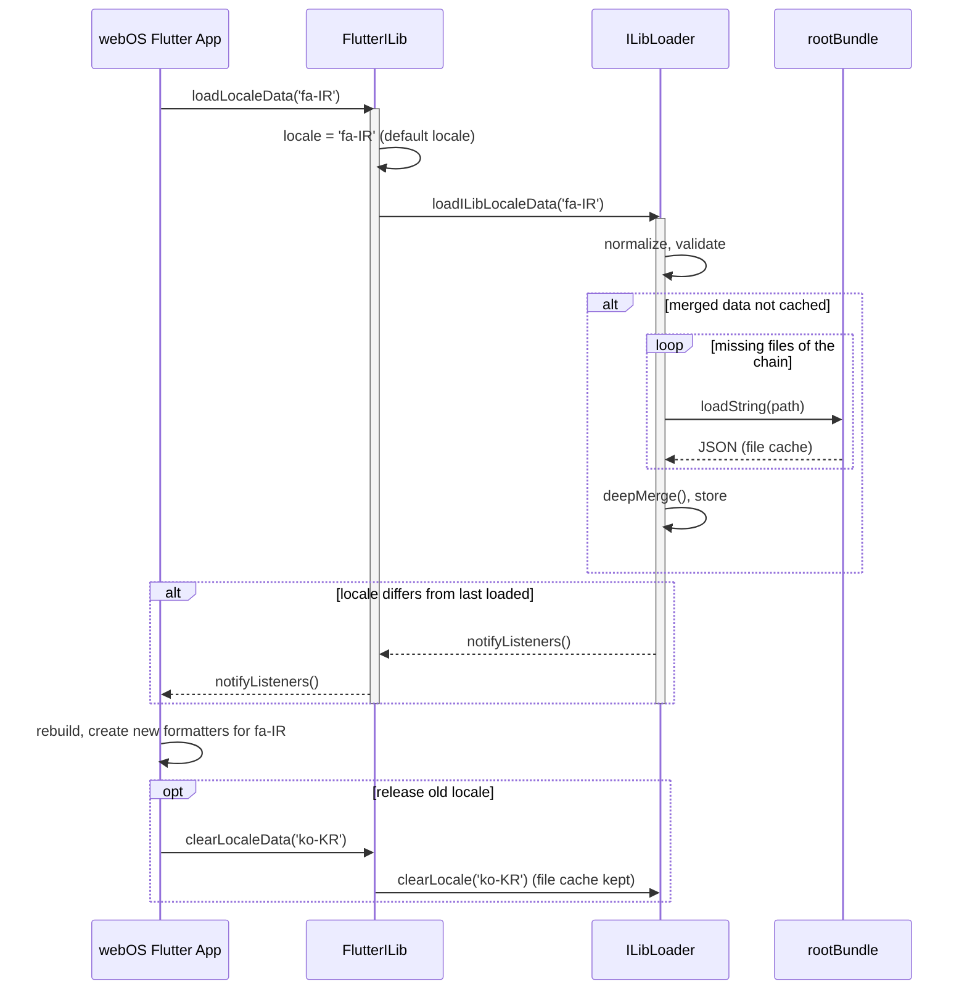
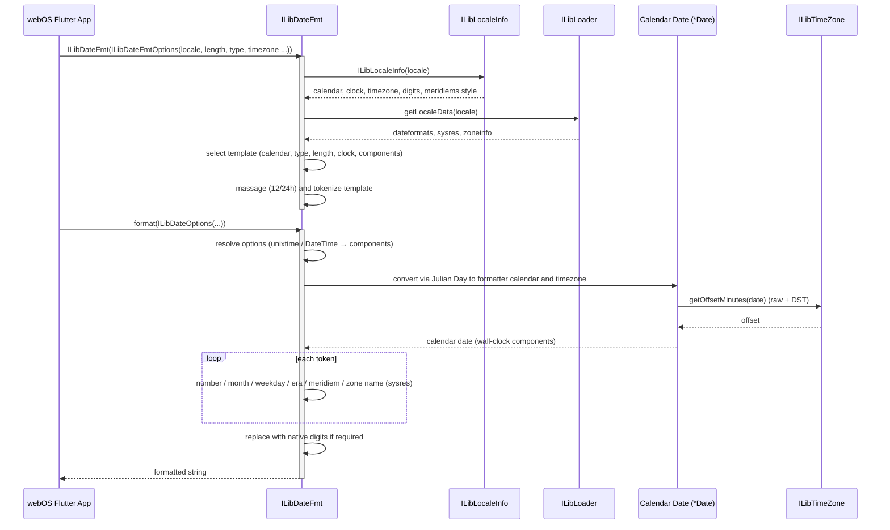
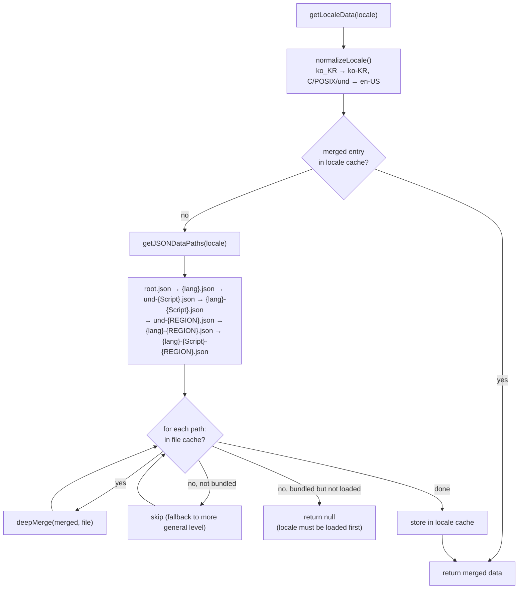
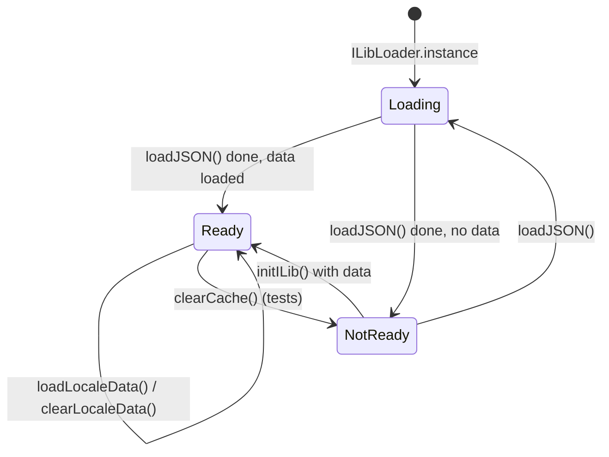
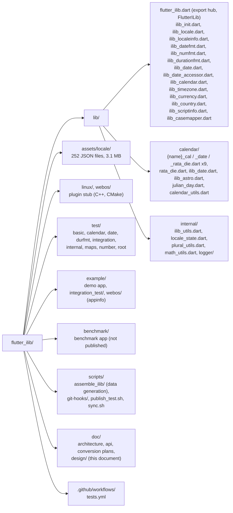

# (LLD) flutter_ilib

| Date | Changes |
| --- | --- |
| 2026-11-03 | Initial LLD for flutter_ilib v2.0 (pure Dart) |

## 1. Document Descriptions

### 1.1 The Purpose of Document

This document describes the low-level design of **flutter_ilib**, the internationalization (i18n)
package for Flutter applications on webOS TV.

flutter_ilib provides, in a single Flutter package, the i18n functions that webOS applications
already get from iLib on the Enact, Node.js and QML stacks: locale-aware date/time, number,
currency and duration formatting, conversion between 9 calendar systems, timezone and DST
calculation, and locale/country/script metadata. webOS supports 144 locales in 66 languages, and
the standard Flutter `intl` package does not cover non-Gregorian calendars, locale-driven calendar
selection or iLib-equivalent output, so a dedicated package is required.

Since v2.0 the package is implemented in pure Dart. It reads the iLib/CLDR locale data (JSON)
bundled with the package and performs all formatting and calculation natively, without the
embedded JavaScript engine (`flutter_js` / QuickJS) that v1.x used.

The purpose of this document is to describe the components of flutter_ilib, how they interact with
each other and with the Flutter framework, and the rationale behind the design, so that it can be
used as a common reference for maintenance, verification and review.

### 1.2 The Scope of Document

This document covers the `flutter_ilib` package v2.0 (`pubspec.yaml` version 2.0.0, converted from
iLib JS v15.0.0, CLDR 48.2 data).

In scope:

* The public Dart API exported from `lib/flutter_ilib.dart` (`FlutterILib`, `ILibLoader`,
  `ILibLocale`, `ILibLocaleInfo`, `ILibDateFmt`, `ILibDurationFmt`, `ILibNumFmt`, `ILibCalendar`
  and the calendar classes, `ILibTimeZone`, `ILibCurrency`, `ILibCountry`, `ILibScriptInfo`,
  `ILibCaseMapper`, `ILibDate` / `ILibDateOptions`)
* Locale data loading, merging and caching (`ILibLoader`)
* The calendar layer (Rata Die pivot, 9 calendars, astronomical calculation)
* The timezone / DST layer, including the system (`'local'`) timezone
* The bundled locale data assets (`assets/locale/`) and their generation tool chain
* The source repository structure, test structure and CI

Out of scope:

* The internal design of iLib JS itself (it is the conversion source, not part of the package)
* The internal design of CLDR and the `ilib-assemble` tool
* The design of the webOS applications that use flutter_ilib
* The Flutter engine and the webOS platform

> **Note:**
> v1.x (JS interop) is referenced only where it explains a design decision or a quality
> attribute target. The public API is unchanged between v1.x and v2.0.

### 1.3 The Organization of Document

This document consists of the following 8 chapters.

| Chapter | Title | Contents |
| --- | --- | --- |
| 1 | Document Descriptions | Purpose, scope, organization, terminology |
| 2 | Project Overview | Stakeholders |
| 3 | Architectural Drivers | Constraints, functional requirements, quality attributes |
| 4 | System Context | System boundary and external entities |
| 5 | Architecture Design | Static (module view), dynamic (C&C view) and physical (allocation view) perspectives |
| 6 | FMEA Review | Failure modes and runtime countermeasures |
| 7 | Product-Line Considerations | Impact on product lines |
| 8 | Reference | Reference material |

### 1.4 Terminology and Definitions

| Definition | Description |
| --- | --- |
| i18n | Internationalization. Adapting output (dates, numbers, names) to the user's language and region. |
| iLib | The JavaScript i18n library (github.com/iLib-js/iLib) used by webOS Enact, Node.js and QML stacks. flutter_ilib v2.0 is a Dart conversion of iLib JS v15.0.0. |
| CLDR | Unicode Common Locale Data Repository. The source of the locale data bundled in flutter_ilib (CLDR 48.2). |
| Locale | A language/script/region combination identified by a BCP-47 tag (e.g. `ko-KR`, `zh-Hans-CN`). |
| BCP-47 | IETF standard for language tags. Parsed by `ILibLocale` into language, script, region and variant. |
| Locale data | The JSON files under `assets/locale/`, generated from iLib and CLDR. Each file holds one level of the locale hierarchy (`root`, `{lang}`, `und-{region}`, `{lang}-{region}` ...). |
| `ilib.data.*` | Top-level keys of the locale data JSON, one per data type (e.g. `ilib.data.localeinfo`, `ilib.data.dateformats`, `ilib.data.sysres`, `ilib.data.zoneinfo`). |
| Deep merge | Recursive merge of the locale data files from the most general (`root.json`) to the most specific file. Values in a more specific file override those in a more general one. |
| `ilib-assemble` | iLib tool that extracts the locale data used by a set of iLib modules and writes it as per-locale JSON files. Generates the JSON files ahead of time, offline (`scripts/assemble_ilib/generate_locale_json.sh`), and the output is committed to the repository as `assets/locale/`. |
| Rata Die (RD) | A continuous count of days from a fixed epoch. Used as the shared pivot coordinate between calendars. |
| Julian Day (JD) | A continuous day count used by astronomers. Used as the intermediate value when converting between calendars. |
| Calendar | A system that maps days to year/month/day. flutter_ilib supports gregorian, julian, thaisolar, islamic, hebrew, ethiopic, coptic, persian (astronomical) and persian-algo (arithmetic). |
| Timezone | An IANA zone (e.g. `Asia/Seoul`) with a standard UTC offset and optional DST rules. |
| DST | Daylight Saving Time. A seasonal shift of the UTC offset defined by start/end rules. |
| Wall-clock time | The local time shown on a clock in a given timezone, as opposed to a UTC instant. |
| `'local'` timezone | The device (system) timezone. Its offsets and DST are taken from the Dart runtime instead of the zoneinfo data. |
| Meridiem | The AM/PM (or locale-specific day period) marker of 12-hour clocks. |
| Plural category | CLDR plural form (`zero`, `one`, `two`, `few`, `many`, `other`) selected by locale-specific rules. Used by duration formatting. |
| Native digits | Locale-specific digit characters (e.g. Persian `۱۲۳`) used instead of Western digits `0-9`. |
| RTL | Right-To-Left script direction (e.g. Arabic, Hebrew, Persian). |
| Golden value | The expected output of iLib JS for a given input. flutter_ilib output must match it exactly. |
| JS interop (v1.x) | The previous implementation, which ran the iLib JS code inside an embedded QuickJS engine through `flutter_js`. |

## 2. Project Overview

### 2.1 The Stakeholders

| Role | Stakeholder |
| --- | --- |
| Project Leader | Yunsik Jang |
| webOS TV Chief Architect | Seokhee Lee |
| Developer | Goun Lee |
| Developer | Seonmi Jin |
| SDET | Yunoh Jeong |

## 3. Architectural Drivers

### 3.1 Constraints

This section describes the constraints on the design of flutter_ilib.

#### 3.1.1 Business Constraints

The business constraints are listed in **[Table 3-1]** .

**[Table 3-1]** Business Constraints

| ID | Constraint | Description |
| --- | --- | --- |
| BC01 | Open-source license (Apache-2.0) | flutter_ilib is distributed under the Apache License 2.0 (copyright JEDLSoft) and is published on github.com/iLib-js/flutter_ilib. Contributions and redistribution must follow the license terms. |
| BC02 | Specification parity with iLib | webOS Flutter apps must show the same i18n output as the webOS apps built on Enact, Node.js and QML, which all use iLib. flutter_ilib output must therefore match iLib JS output exactly. |
| BC03 | webOS supported locales | The package must support the 144 locales (66 languages) supported by webOS. The authoritative list is `scripts/assemble_ilib/locales.json`. |
| BC04 | Upstream version alignment | The Dart code is converted from iLib JS v15.0.0, and the bundled data is CLDR 48.2. The iLib source and the locale data must be updated together; a code-only or data-only update makes the output diverge. |

\*BC: Business Constraint

#### 3.1.2 Technical Constraints

The technical constraints are listed in **[Table 3-2]** .

**[Table 3-2]** Technical Constraints

| ID | Constraint | Description |
| --- | --- | --- |
| TC01 | Pure Dart, no JS runtime | The package must not embed a JavaScript engine or a native library. All logic is implemented in Dart, and the locale data is read directly from JSON. |
| TC02 | Minimum SDK | Dart `>=3.1.5 <4.0.0`, Flutter `>=3.13.9` (`pubspec.yaml`). Language features newer than this floor cannot be used, and the code uses the short `dart format` style at page width 80. |
| TC03 | Target platforms | The package is a Flutter plugin for `linux` and `webos` (`pluginClass: FlutterIlibPlugin`). The native plugin part is a stub; no platform channel is used by the Dart code. |
| TC04 | Bundled data, asynchronous loading | Locale data is available only as Flutter assets (`assets/locale/`, 252 files, 3.1 MB) and is read through `rootBundle`, which is asynchronous. The formatting APIs are synchronous, so data must be loaded before a formatter is created. |
| TC05 | Minimal dependencies | Runtime dependencies are limited to `flutter`, `logging` and `plugin_platform_interface`. |
| TC06 | Output equality with iLib JS | The unit tests are converted 1:1 from the iLib JS tests, and the expected values are not changed except when iLib itself is updated. Any behavior change must keep all converted tests passing. |

\*TC: Technical Constraint

### 3.2 Functional Requirements

The functional requirements are listed in **[Table 3-3]** .

**[Table 3-3]** Functional Requirements

| Group                 | ID     | Function                    | Description                                                                                                                                                                                                                                                                                                                                                                                | Test Scenario (Test Case) |
|-----------------------|--------|-----------------------------|--------------------------------------------------------------------------------------------------------------------------------------------------------------------------------------------------------------------------------------------------------------------------------------------------------------------------------------------------------------------------------------------|---------------------------|
| Initialization / Data | FR1-1  | Initial data loading        | **On first access, the package loads `root.json` and the data of the system locale, and reports readiness.**  - The system locale is taken from the platform locale; `C`, `POSIX`, empty and `und` map to `en-US`.  - An invalid system locale falls back to `en-US`.  - Listeners of `FlutterILib.instance` are notified when loading completes, and `isILibReady` becomes true. | [test/basic/flutter_ilib_test.dart](../../test/basic/flutter_ilib_test.dart) [test/integration/example_app_api_test.dart](../../test/integration/example_app_api_test.dart) [example/integration_test/example_app_integration_test.dart](../../example/integration_test/example_app_integration_test.dart) [example/integration_test/plugin_integration_test.dart](../../example/integration_test/plugin_integration_test.dart) |
| Initialization / Data | FR1-2  | Locale change               | **`FlutterILib.instance.loadLocaleData(locale)` sets the default locale, loads the locale data and notifies listeners.**  - Reloading the last loaded locale does not notify.  - Invalid locales are ignored.                                                                                                                                                                        | [test/basic/flutter_ilib_locale_test.dart](../../test/basic/flutter_ilib_locale_test.dart) [test/basic/ilib_loader_cache_test.dart](../../test/basic/ilib_loader_cache_test.dart) |
| Initialization / Data | FR1-3  | Default locale              | **Formatters created without `locale` use the library-wide default locale (`FlutterILib.instance.locale`).**  - Setting `locale` only changes the default; it does not load data.                                                                                                                                                                                                       | [test/internal/locale_state_test.dart](../../test/internal/locale_state_test.dart) |
| Initialization / Data | FR1-4  | Locale data resolution      | **Locale data is resolved by deep-merging the files of the locale hierarchy:**  `root` → `{lang}` → `und-{script}` → `{lang}-{script}` → `und-{region}` → `{lang}-{region}` → `{lang}-{script}-{region}`.  - Missing files are skipped (e.g. `en-CW` falls back to `en`).                                                                                                      | [test/internal/utils_test.dart](../../test/internal/utils_test.dart) [test/basic/ilib_loader_cache_test.dart](../../test/basic/ilib_loader_cache_test.dart) |
| Initialization / Data | FR1-5  | Releasing locale data       | **`FlutterILib.instance.clearLocaleData(locale)` removes the merged data of one locale.**  - Other locales and readiness are not affected.                                                                                                                                                                                                                                              | [test/basic/ilib_loader_cache_test.dart](../../test/basic/ilib_loader_cache_test.dart) |
| Locale                | FR2-1  | BCP-47 parsing              | **`ILibLocale` parses a locale tag into language, script, region and variant**, generates the normalized spec, converts ISO alpha-2/alpha-3 codes and validates the tag.                                                                                                                                                                                                                   | [test/root/locale_test.dart](../../test/root/locale_test.dart) [test/root/locale_extra_test.dart](../../test/root/locale_extra_test.dart) [test/basic/flutter_ilib_locale_test.dart](../../test/basic/flutter_ilib_locale_test.dart) |
| Locale                | FR2-2  | Available locales           | **`ILibLocale.getAvailableLocales()` returns the list of bundled locales.**                                                                                                                                                                                                                                                                                                                | [test/root/locale_extra_test.dart](../../test/root/locale_extra_test.dart) |
| Locale Info           | FR3-1  | Locale metadata             | **`ILibLocaleInfo` returns the conventions of a locale:** clock (12/24), default calendar, default timezone, currency, first day of week, weekend, measurement units, paper size, quotation marks, decimal/grouping separators, grouping digits, percentage and currency formats, digit style, native digits, rounding mode, scripts and meridiem style.                                   | [test/root/localeinfo_test.dart](../../test/root/localeinfo_test.dart) [test/root/localeinfo_dayofweek_test.dart](../../test/root/localeinfo_dayofweek_test.dart) [test/basic/flutter_ilib_localeinfo_test.dart](../../test/basic/flutter_ilib_localeinfo_test.dart) |
| Date / Time Format    | FR4-1  | Date/time formatting        | **`ILibDateFmt.format(date)` formats a date with the locale template.**  - Options: `length` (short/medium/long/full), `type` (date/time/datetime), `date` and `time` components, `clock` (12/24), `template`, `timezone`, `calendar`, `useNative`, `meridiems`.                                                                                                                        | [test/date/datefmt_*_test.dart (per-locale, 91 files)](../../test/date/) [test/date/datefmt_template_test.dart](../../test/date/datefmt_template_test.dart) [test/date/datefmt_Clock_test.dart](../../test/date/datefmt_Clock_test.dart) [test/date/date_test.dart](../../test/date/date_test.dart) [test/basic/flutter_ilib_datefmt_test.dart](../../test/basic/flutter_ilib_datefmt_test.dart) |
| Date / Time Format    | FR4-2  | Calendar-aware formatting   | **The date is converted to the calendar of the formatter (from the option or the locale default) before formatting.**  - e.g. `fa-IR` formats in the Persian calendar, `th-TH` in the Thai solar calendar, `am-ET` in the Ethiopic calendar.                                                                                                                                            | [test/date/datefmt_datetime_calendar_extra_test.dart](../../test/date/datefmt_datetime_calendar_extra_test.dart) [test/date/datefmt_timezone_calendar_extra_test.dart](../../test/date/datefmt_timezone_calendar_extra_test.dart) |
| Date / Time Format    | FR4-3  | Localized names and digits  | **Month, weekday, era and meridiem names come from the locale's translated strings, and digits are replaced with native digits when `useNative` is set or the locale uses native digits by default.**                                                                                                                                                                                      | [test/date/datefmt_MonthTranslation_test.dart](../../test/date/datefmt_MonthTranslation_test.dart) [test/date/datefmt_WeekdayTranslation_test.dart](../../test/date/datefmt_WeekdayTranslation_test.dart) [test/date/datefmt_Meridiems_test.dart](../../test/date/datefmt_Meridiems_test.dart) |
| Date / Time Format    | FR4-4  | Format metadata             | **`ILibDateFmt` returns its template, clock, calendar, meridiem ranges and the order of date components.**                                                                                                                                                                                                                                                                                 | [test/date/datefmt_template_test.dart](../../test/date/datefmt_template_test.dart) [test/date/datefmt_Meridiems_test.dart](../../test/date/datefmt_Meridiems_test.dart) [test/basic/flutter_ilib_datefmt_test.dart](../../test/basic/flutter_ilib_datefmt_test.dart) |
| Calendar              | FR5-1  | Calendar rules              | **`ILibCalendar(type)` / `ILibCalendar.fromLocale(locale)` return the number of months, month length and leap year rule of a calendar.**  - Supported types: gregorian, julian, thaisolar, islamic, hebrew, ethiopic, coptic, persian, persian-algo.                                                                                                                                    | [test/calendar/testcalendar_test.dart](../../test/calendar/testcalendar_test.dart) [test/calendar/testgregorian_test.dart](../../test/calendar/testgregorian_test.dart) [test/calendar/testthaisolar_test.dart](../../test/calendar/testthaisolar_test.dart) [test/calendar/testjulian_test.dart](../../test/calendar/testjulian_test.dart) [test/calendar/testislamic_test.dart](../../test/calendar/testislamic_test.dart) [test/calendar/testhebrew_test.dart](../../test/calendar/testhebrew_test.dart) [test/calendar/testethiopic_test.dart](../../test/calendar/testethiopic_test.dart) [test/calendar/testcoptic_test.dart](../../test/calendar/testcoptic_test.dart) [test/calendar/testpersian_test.dart](../../test/calendar/testpersian_test.dart) |
| Calendar              | FR5-2  | Calendar date conversion    | **A date in one calendar can be converted to any other supported calendar (via Rata Die / Julian Day)**, and each calendar date provides year/month/day/time components, day of week, day of year, week of year, week of month, era, Julian Day and Unix time.                                                                                                                             | [test/calendar/testgregoriandate_test.dart](../../test/calendar/testgregoriandate_test.dart) [test/calendar/testthaisolardate_test.dart](../../test/calendar/testthaisolardate_test.dart) [test/calendar/testjuliandate_test.dart](../../test/calendar/testjuliandate_test.dart) [test/calendar/testislamicdate_test.dart](../../test/calendar/testislamicdate_test.dart) [test/calendar/testhebrewdate_test.dart](../../test/calendar/testhebrewdate_test.dart) [test/calendar/testethiopicdate_test.dart](../../test/calendar/testethiopicdate_test.dart) [test/calendar/testcopticdate_test.dart](../../test/calendar/testcopticdate_test.dart) [test/calendar/testpersiandate_test.dart](../../test/calendar/testpersiandate_test.dart) [test/calendar/testpersiandateastro_test.dart](../../test/calendar/testpersiandateastro_test.dart) [test/calendar/testgregratadie_test.dart](../../test/calendar/testgregratadie_test.dart) [test/calendar/testjulianday_test.dart](../../test/calendar/testjulianday_test.dart) [test/calendar/testastro_test.dart](../../test/calendar/testastro_test.dart) [test/calendar/testpersianastro_test.dart](../../test/calendar/testpersianastro_test.dart) |
| Calendar              | FR5-3  | Unsupported calendar        | **Requesting the Han calendar raises `UnimplementedError`; an unknown calendar raises `ArgumentError`.**                                                                                                                                                                                                                                                                                   | [test/calendar/testcalendar_test.dart](../../test/calendar/testcalendar_test.dart) [test/calendar/testcalendar_extra_test.dart](../../test/calendar/testcalendar_extra_test.dart) |
| Time Zone             | FR6-1  | Offset and DST              | **`ILibTimeZone` returns the raw offset, DST savings, effective offset, DST state and display name (abbreviation or RFC 822) of a zone at a given date.**  - DST start/end rules are taken from `ilib.data.zoneinfo`.  - Unknown zones fall back to `Etc/UTC`.                                                                                                                       | [test/calendar/timezone_test.dart](../../test/calendar/timezone_test.dart) [test/calendar/timezone_extra_test.dart](../../test/calendar/timezone_extra_test.dart) |
| Time Zone             | FR6-2  | System timezone             | **`timezone: 'local'` (also the default when no timezone is given to a date) uses the device timezone, including its DST, from the Dart runtime.**                                                                                                                                                                                                                                         | [test/calendar/timezone_extra_test.dart](../../test/calendar/timezone_extra_test.dart) [test/calendar/timezone_test.dart](../../test/calendar/timezone_test.dart) [test/integration/example_app_api_test.dart](../../test/integration/example_app_api_test.dart) |
| Time Zone             | FR6-3  | Zone list                   | **`ILibTimeZone.getAvailableIds([country])` returns the available zone ids, optionally per country.**                                                                                                                                                                                                                                                                                      | [test/calendar/timezone_test.dart](../../test/calendar/timezone_test.dart) |
| Number Format         | FR7-1  | Number formatting           | **`ILibNumFmt.format(number)` formats a number with the locale separators, grouping (including secondary grouping) and digits.**  - Options: `maxFractionDigits`, `minFractionDigits`, `significantDigits`, `roundingMode`, `style` (standard/scientific/nogrouping/native), `useNative`.                                                                                               | [test/number/numfmt_test.dart](../../test/number/numfmt_test.dart) [test/number/numfmt2_test.dart](../../test/number/numfmt2_test.dart) [test/number/numfmt_af_test.dart](../../test/number/numfmt_af_test.dart) [test/number/numfmt_am_test.dart](../../test/number/numfmt_am_test.dart) [test/number/numfmt_extra_test.dart](../../test/number/numfmt_extra_test.dart) [test/basic/flutter_ilib_numfmt_test.dart](../../test/basic/flutter_ilib_numfmt_test.dart) [test/internal/math_utils_test.dart](../../test/internal/math_utils_test.dart) |
| Number Format         | FR7-2  | Percentage formatting       | **`type: 'percentage'` formats the number with the locale percentage template.**                                                                                                                                                                                                                                                                                                           | [test/number/numfmt_test.dart](../../test/number/numfmt_test.dart) [test/number/numfmt2_test.dart](../../test/number/numfmt2_test.dart) [test/number/numfmt_af_test.dart](../../test/number/numfmt_af_test.dart) [test/number/numfmt_am_test.dart](../../test/number/numfmt_am_test.dart) |
| Number Format         | FR7-3  | Currency formatting         | **`type: 'currency'` formats an amount with the currency sign or ISO code, the currency fraction digits and the locale currency template.**  - A currency code is required; an unknown code raises `ArgumentError`.                                                                                                                                                                     | [test/number/numfmt_test.dart](../../test/number/numfmt_test.dart) [test/number/numfmt2_test.dart](../../test/number/numfmt2_test.dart) [test/number/currency_test.dart](../../test/number/currency_test.dart) |
| Currency              | FR8-1  | Currency metadata           | **`ILibCurrency` returns the code, name, sign and fraction digits of a currency, looked up by code, by sign or by locale default.**                                                                                                                                                                                                                                                        | [test/number/currency_test.dart](../../test/number/currency_test.dart) [test/number/currency_extra_test.dart](../../test/number/currency_extra_test.dart) |
| Duration Format       | FR9-1  | Duration formatting (text)  | **`ILibDurationFmt.format(duration)` formats years, months, weeks, days, hours, minutes, seconds and milliseconds with the locale plural rules.**  - `length`: short/medium/long/full.                                                                                                                                                                                                  | [test/durfmt/durfmt_test.dart](../../test/durfmt/durfmt_test.dart) [test/durfmt/durfmt2_test.dart](../../test/durfmt/durfmt2_test.dart) [test/internal/plural_test.dart](../../test/internal/plural_test.dart) |
| Duration Format       | FR9-2  | Duration formatting (clock) | **`style: 'clock'` formats hours, minutes and seconds as a clock string (e.g. `01:30`).**                                                                                                                                                                                                                                                                                                  | [test/durfmt/durfmt_test.dart](../../test/durfmt/durfmt_test.dart) [test/durfmt/durfmt_or_IN_test.dart](../../test/durfmt/durfmt_or_IN_test.dart) [test/durfmt/durfmt_sw_KE_test.dart](../../test/durfmt/durfmt_sw_KE_test.dart) |
| Duration Format       | FR9-3  | RTL output                  | **For locales with an RTL script, the result is prefixed with the RTL mark (U+200F).**                                                                                                                                                                                                                                                                                                     | [test/durfmt/durfmt_ar_SA_test.dart](../../test/durfmt/durfmt_ar_SA_test.dart) |
| Country               | FR10-1 | Country lookup              | **`ILibCountry` converts a country code to its localized name and back**, and lists the available codes and names.                                                                                                                                                                                                                                                                         | [test/root/country_test.dart](../../test/root/country_test.dart) [test/root/country_extra_test.dart](../../test/root/country_extra_test.dart) |
| Script Info           | FR11-1 | Script metadata             | **`ILibScriptInfo` returns the ISO 15924 code, number, name, long code, direction, IME need and casing of a script.**                                                                                                                                                                                                                                                                      | [test/root/scriptinfo_test.dart](../../test/root/scriptinfo_test.dart) |
| Case Mapper           | FR12-1 | Case conversion             | **`ILibCaseMapper.map(text)` converts text to upper or lower case with locale rules** (e.g. Turkish/Azeri dotted and dotless i, German ß, Greek final sigma).                                                                                                                                                                                                                             | [test/maps/upper_test.dart](../../test/maps/upper_test.dart) [test/maps/lower_test.dart](../../test/maps/lower_test.dart) |
| Version               | FR13-1 | Version information         | **`FlutterILib.instance` returns the package version, the iLib version and the CLDR version.**                                                                                                                                                                                                                                                                                             | [test/basic/flutter_ilib_test.dart](../../test/basic/flutter_ilib_test.dart) |

> **Note:**
> The test cases are the unit and integration tests in this repository, linked per requirement. They
> run in GitHub Actions (`.github/workflows/tests.yml`) on every push through `execute_test.sh`:
> `test/` (except `test/integration/`) as unit tests on the latest stable, 3.38.10 and the minimum
> supported Flutter 3.13.9; `test/integration/` and `example/integration_test/` (Linux, `xvfb`) as
> integration tests on the latest stable and 3.38.10 only. JIRA test case IDs are not assigned yet.

### 3.3 Quality Attribute

This section describes the non-functional requirements (quality attributes) that flutter_ilib must
satisfy. The performance and memory targets are based on the benchmark app measured on a webOS
**O26 high-end device** (Flutter 3.38.10, profile mode, workload over 5 locales: en-US, en-GB, ko-KR,
fa-IR, am-ET). The measured values are shown in **[Table 3-5]** , and the test cases are described
in 3.3.1.

> **Note:**
> All reference results in this document were measured on the O26 high-end device only. Mid-range
> and low-end devices may give worse results (slower startup and formatting, different memory
> figures), so the pass criteria must be re-checked on each target device class.

**[Table 3-4]** Quality Attributes

| ID | Attribute | Scenario | Test Case | Difficulty | Importance |
| --- | --- | --- | --- | --- | --- |
| QA01 | Performance (startup) | In the benchmark app on webOS, the time from initialization to `isILibReady == true` must not exceed **150 ms**. (Measured on O26: 115 ms; v1.9.0: 279 ms) | [TC-QA01](#331-benchmark-test-cases) | Mid | High |
| QA02 | Performance (date formatting) | In the benchmark app on webOS, a reused `ILibDateFmt.format()` call must take **≤ 500 µs/op** on average. (Measured on O26: 309 µs/op; v1.9.0: 4,060 µs/op) | [TC-QA02](#331-benchmark-test-cases) | Mid | High |
| QA03 | Memory (peak and stability) | In the benchmark app on webOS, the maximum RSS must not exceed the v1.9.0 baseline (**73.2 MB**) and must stay flat during the sustained workload (6 rounds × 5,000 operations; **RSS of round 6 − round 1 ≤ 2 MB**, no monotonic growth). (Measured on O26: 51.7 MB, flat; v1.9.0: 73.2 MB, rising) | [TC-QA03](#331-benchmark-test-cases) | Mid | High |

**[Table 3-5]** Benchmark Measurements on the webOS O26 high-end device (v1.9.0 JS interop vs v2.0.0 pure Dart)

| Metric | webOS v1.9.0 | webOS v2.0.0 |
| --- | ---: | ---: |
| Startup (init → ready) | 279 ms | 115 ms |
| Date `format()` (reused) | 4,060 µs/op | 309 µs/op |
| `LocaleInfo` lookup | 204 µs/op | 2.58 µs/op |
| Full workload | 186,262 ms | 13,458 ms |
| Max memory (RSS) | 73.2 MB | 51.7 MB |
| Memory under sustained load | rising | flat |

> **Note:**
> Speed is measured with `Stopwatch` in the benchmark app, and memory is sampled with the
> memorymanager `getUnitList` API. Per-operation values vary ±10–20% between runs, so they are to
> be read as orders of magnitude, and memory is judged by its trend (flat vs. growing) rather than
> by absolute values. In real apps (settings date/time screen, screensaver) the idle RSS of v2.0.0
> is also lower than v1.x in every measured locale (settings −3 to −5%, screensaver about −11%).

#### 3.3.1 Benchmark Test Cases

The benchmark app (`benchmark/lib/benchmark.dart`) prints the measurements that QA01 – QA03 need, so
these quality attributes are verified by running it on the target device.

Procedure (manual, webOS device, release build):

1. Go to the `benchmark/` directory of the source tree.
2. Create the webOS platform files: `flutter-webos create --platforms webos .`
3. Build the IPK: `flutter-webos build webos --ipk --release`
4. Install and run the app on the target: `flutter-webos run -d <webos_custom_device> --release`.
   The benchmark runs on the target, and the measurements appear on its screen. Wait until the
   `RSS peak` row appears.
5. Repeat step 4 three times and use the median of the runs. Record the device model and build
   together with the results.

**[Table 3-6]** Benchmark Test Cases

| TC ID | QA | Benchmark output | Pass criterion | Reference result (O26 high-end, v2.0.0) |
| --- | --- | --- | --- | --- |
| TC-QA01 | QA01 | `init → ready` | ≤ 150 ms | 115 ms |
| TC-QA02 | QA02 | `format() reused` | ≤ 500 µs/op | 309 µs/op |
| TC-QA03 | QA03 | `RSS peak`, `RSS sustain r1` – `r6` | peak ≤ 73.2 MB and r6 − r1 ≤ 2 MB | 51.7 MB, flat |

## 4. System Context

This chapter describes the system context of flutter_ilib, identifies the external entities and
defines the system boundary.

flutter_ilib is not a process or a service. It is a Dart library that is compiled into each webOS
Flutter application, together with its locale data assets. The system boundary is the
`flutter_ilib` package: its Dart code (`lib/`) and its bundled data (`assets/locale/`). The host
application calls the public API; flutter_ilib in turn uses the Flutter framework to read the
bundled assets and the platform locale, and the Dart runtime for the system timezone. The locale
data is generated ahead of time from iLib and CLDR by `ilib-assemble`, run offline when the
iLib/CLDR version is bumped; its output is committed to the repository as the `assets/locale/`
files and is not regenerated by the Flutter build.

The context diagram is shown in **[Figure 4-1]** , and the responsibilities of the entities and
relationships are described in **[Table 4-1]** and **[Table 4-2]** .

**[Figure 4-1]** System Context Diagram

> **Notation:** Thick-bordered box = system boundary (flutter_ilib). Rounded box = host application.
> Cylinder = data store. Solid arrow = runtime call or data access (caller → callee). Dotted arrow =
> callback/notification, registration, or offline (data generation) relationship.

**[Table 4-1]** Entity Responsibility Catalog for System Context

*Associated Drawings: [Figure 4-1]*

| Entity | Responsibility |
| --- | --- |
| webOS TV Flutter App | Host application. Creates flutter_ilib formatters and info objects, listens to `FlutterILib.instance` for readiness, and requests locale changes. |
| flutter_ilib | The target system. Loads and merges the locale data, and provides formatting, calendar, timezone and locale metadata APIs in pure Dart. |
| Flutter Framework | Provides `rootBundle` / `AssetManifest` (asset access), `PlatformDispatcher` (platform locale) and `ChangeNotifier` (listener notification). |
| Bundled locale data (`assets/locale/`) | Hierarchical JSON files (252 files) holding the iLib/CLDR data for the 144 supported locales and the locale-independent root data. Packaged with the application. |
| Dart Runtime | Provides `DateTime`, used to get the system timezone offset for the `'local'` timezone and the current time. |
| `package:logging` | Logging back end of the internal logger. |
| Native plugin stub (linux / webos) | Registers the package as a Flutter plugin on Linux and webOS. It holds no i18n logic. |
| `ilib-assemble` (iLib + CLDR) | Offline tool, run when the iLib/CLDR version is bumped, that extracts the locale data from iLib v15.0.0 (CLDR 48.2) and writes the JSON files committed under `assets/locale/`. Not run as part of the Flutter build and not used at runtime. |

**[Table 4-2]** Relationship Responsibility Catalog for System Context

*Associated Drawings: [Figure 4-1]*

| Relationship | Responsibility |
| --- | --- |
| webOS TV Flutter App → flutter_ilib | Calls the public Dart API: `FlutterILib.instance.loadLocaleData()`, `ILibDateFmt(...).format()`, `ILibNumFmt(...).format()`, `ILibLocaleInfo(...)` etc. |
| flutter_ilib → webOS TV Flutter App | Notifies listeners when the initial data is ready and when a new locale has been loaded, so the app can rebuild its UI. |
| flutter_ilib → Flutter Framework | Reads the asset manifest and the locale JSON files asynchronously through `rootBundle`, and reads the platform locale through `PlatformDispatcher`. |
| Flutter Framework → Bundled locale data | Reads the asset files packaged with the application. |
| flutter_ilib → Dart Runtime | Gets the system UTC offset at a wall-clock time or at an instant for the `'local'` timezone. |
| flutter_ilib → `package:logging` | Writes debug/info/warning/error logs. |
| Native plugin stub → flutter_ilib | Plugin registration only; no method is called by the Dart code. |
| `ilib-assemble` → Bundled locale data | Generates the JSON files ahead of time, offline (`scripts/assemble_ilib/generate_locale_json.sh`); the output is committed to the repository, not regenerated by the Flutter build. |

## 5. Architecture Design

This chapter describes the architecture design of flutter_ilib. The system is decomposed top-down;
for each decomposition the responsibilities of the elements and relationships, and the rationale
with its associated quality attributes, are described.

### 5.1 Static Perspectives

This section describes the static structure (module view) of flutter_ilib. The elements are Dart
libraries (files) and classes; the relationships are *depends-on* (imports / uses) and *is-part-of*.

#### 5.1.1 First Decomposition Diagram

flutter_ilib is first decomposed into the layers shown in **[Figure 5-1]** .

**[Figure 5-1]** First Decomposition Diagram

> **Notation:** Box = Dart class or library. Subgraph = layer. Cylinder = bundled data. Arrow =
> *depends-on* (A uses B). The `Internal` libraries are not exported from `lib/flutter_ilib.dart`.

**[Table 5-1]** Element Responsibility Catalog for First Decomposition

*Associated Drawings: [Figure 5-1], Perspective: Static*

| Element | Responsibility |
| --- | --- |
| **Facade / Loader Layer** | |
| `FlutterILib` (`lib/flutter_ilib.dart`) | Application-facing singleton (`ChangeNotifier`). Exposes readiness (`isILibReady`), the default locale (`locale`), `loadLocaleData()`, `clearLocaleData()` and version information. Re-broadcasts `ILibLoader` notifications to the app. Also the export hub of the public API. |
| `ILibLoader` (`lib/ilib_init.dart`) | Singleton (`ChangeNotifier`) that loads the asset manifest and the locale JSON files, deep-merges them per locale, caches the raw files and the merged data, and tracks readiness. Provides `getLocaleData(locale)` and `getRootData()` to all other classes. |
| **Formatter Layer** | |
| `ILibDateFmt` (`lib/ilib_datefmt.dart`) | Date/time formatting. Selects and tokenizes the locale template, converts the date to the formatter's calendar and timezone, and substitutes tokens with localized values. |
| `ILibNumFmt` (`lib/ilib_numfmt.dart`) | Number, percentage and currency formatting with rounding, grouping and native digits. |
| `ILibDurationFmt` (`lib/ilib_durationfmt.dart`) | Duration formatting in text style (plural-aware unit strings) or clock style (via `ILibDateFmt`). |
| **Domain Layer** | |
| Calendar / Date (`lib/ilib_calendar.dart`, `lib/ilib_date.dart`, `lib/ilib_date_accessor.dart`, `lib/calendar/`) | Calendar rules and calendar dates for 9 calendars, converted through the Rata Die / Julian Day pivot. `ILibDateOptions` is the user-facing date input. See 5.1.2. |
| `ILibTimeZone` (`lib/ilib_timezone.dart`) | Raw offset, DST rules and display names from `ilib.data.zoneinfo`, plus the system timezone (`'local'`). |
| `ILibCurrency` (`lib/ilib_currency.dart`) | Currency metadata (code, name, sign, fraction digits). |
| `ILibCountry` (`lib/ilib_country.dart`) | Country code ↔ localized name. |
| `ILibScriptInfo` (`lib/ilib_scriptinfo.dart`) | ISO 15924 script metadata (locale independent). |
| `ILibCaseMapper` (`lib/ilib_casemapper.dart`) | Locale-aware upper/lower case conversion. Uses built-in tables, no locale data. |
| **Locale Layer** | |
| `ILibLocale` (`lib/ilib_locale.dart`) | BCP-47 parsing, normalization, validation and ISO code conversion. Value object used by all other classes. |
| `ILibLocaleInfo` (`lib/ilib_localeinfo.dart`) | Locale conventions from `ilib.data.localeinfo`, with built-in defaults when data is missing. The entry point through which formatters determine calendar, clock, timezone, digits and separators. |
| **Internal** | |
| `ilib_utils` | Stateless helpers: `normalizeLocale()`, `getJSONDataPaths()`, `isValidLocale()`, `getSupportedLocales()`. |
| `locale_state` | Owner of the library-wide default locale (`currentLocale`), initialized from the platform locale. |
| `plural_utils` | CLDR plural rule evaluation (`getPluralCategory()`). |
| `math_utils` | Rounding functions for number formatting. |
| `logger` | `LogAdapter` interface and `Logger` implementation on `package:logging`. |
| **Data** | |
| `assets/locale/*.json` | Hierarchical locale data generated from iLib/CLDR. |

The locale data keys used by each class are listed in **[Table 5-2]** .

**[Table 5-2]** Locale Data Keys per Class

| Class | Data keys (`ilib.data.*`) | Source |
| --- | --- | --- |
| `ILibLocaleInfo` | `localeinfo` (incl. `numfmt`, `native_numfmt`, `currency`, `scripts`) | Locale data |
| `ILibDateFmt` | `dateformats`, `sysres`, `zoneinfo` | Locale data |
| `ILibDurationFmt` | `sysres`, `plurals` (+ `dateformats` through `ILibDateFmt` for clock style) | Locale data |
| `ILibNumFmt` | via `ILibLocaleInfo` and `ILibCurrency` | Locale data |
| `ILibCurrency` | `currency` | Root data (+ locale default from `localeinfo.currency`) |
| `ILibTimeZone` | `zoneinfo` (incl. `zonetab`) | Locale data |
| `ILibCountry` | `ctryreverse` | Locale data (root as fallback) |
| `ILibScriptInfo` | `scripts` | Root data |
| `ILibAstro` | `astro` | Root data |

**[Table 5-3]** Rationale Description for First Decomposition

*Associated Drawings: [Figure 5-1]*

| Associated Quality Attribute | Rationale |
| --- | --- |
| Performance (QA01, QA02) | All formatting and lookup is done in Dart on Dart maps. Removing the JS bridge round-trip (`evaluate()` per call in v1.x) is the main reason for the 13–79× speed-up measured on webOS. |
| Memory (QA03) | Without an embedded JS engine, objects are reclaimed by the Dart GC, so memory stays flat under load. The data is loaded per locale (current locale plus its fallback chain), not all at once. |

#### 5.1.2 Second Decomposition Diagram

The calendar subsystem is decomposed as shown in **[Figure 5-2]** . Each calendar is implemented as
three classes: a `*Cal` class (calendar rules), a `*Date` class (calendar date) and a `*RataDie`
class (conversion between date components and Rata Die).

**[Figure 5-2]** Second Decomposition Diagram (Calendar Subsystem)

> **Notation:** Box = Dart class. Subgraph = group of the 9 per-calendar classes of the same role.
> Arrow labels: *implements* / *extends* = type relationship; unlabeled = *depends-on*.

**[Table 5-4]** Element Responsibility Catalog for Second Decomposition

*Associated Drawings: [Figure 5-2], Perspective: Static*

| Element | Responsibility |
| --- | --- |
| `ILibDateOptions` (`lib/ilib_date.dart`) | User-facing date input. Holds date components or an instant (`unixtime`, `julianday`, `rd`, `dateTime`) plus `locale`, `timezone`, `calendar`. Selects the calendar (`type` → `calendar` → locale default → gregorian) and builds the matching `*Date` on access. |
| `ILibDate` (`lib/ilib_date_accessor.dart`) | Read interface shared by `ILibDateOptions` and all calendar dates: components, day of week/year, week of year/month, era, Rata Die, Julian Day, Unix time, calendar, timezone. |
| `ILibCalendar` (`lib/ilib_calendar.dart`) | Calendar rule interface (`getNumMonths`, `getMonLength`, `isLeapYear`) and factory by type or locale. `han` raises `UnimplementedError`, unknown types raise `ArgumentError`. |
| `ILibCalendarDate` (`lib/calendar/ilib_date.dart`) | Abstract base of all calendar dates. Holds the shared logic: timezone adjustment (wall-clock ↔ UTC), week calculations, `onOrBefore`/`onOrAfter`, Unix time and Julian Day conversion. |
| `ILibRataDie` (`lib/calendar/rata_die.dart`) | Abstract day count. Shared static helpers (Unix time ↔ RD, day of week, `onOrBefore`) and the per-calendar conversion contract. |
| `*Cal` | Month count, month length and leap year rule of one calendar (e.g. Ethiopic: 13 months; Persian: leap year by astronomical new year; Persian-algo: 2820-year cycle). |
| `*Date` | Calendar date of one calendar. Built from components (then adjusted for the timezone) or from an instant (then decomposed into wall-clock components). |
| `*RataDie` | Converts between date components and RD for one calendar, using the calendar epoch (e.g. Gregorian JD 1721424.5, Islamic 1948439.5, Hebrew 347997.25, Ethiopic 1724219.75). |
| `ILibAstro` (`lib/calendar/ilib_astro.dart`) | Astronomical routines (equinox, delta-T, nutation, solar longitude, equation of time) using `ilib.data.astro`. Used by the Persian (astronomical) calendar to find the new year at the Tehran meridian. |
| `JulianDay` | Julian Day value with integer and fractional parts. |
| `calendar_utils` | Non-negative `mod()` and `floorDiv()` used by all calendar arithmetic. |
| `ILibTimeZone` | Supplies the UTC offset (including DST) used to convert between wall-clock time and the UTC instant. |

### 5.2 Dynamic Perspectives

This section describes the runtime structure (component-and-connector view) of flutter_ilib.
flutter_ilib runs entirely in the main isolate of the host application; it creates no isolate,
thread or process. Two kinds of runtime paths exist:

* **Asynchronous load path** — `ILibLoader` reads the asset manifest and the locale JSON files
  through `rootBundle` and notifies listeners when done.
* **Synchronous compute path** — formatter and info objects read the already merged data from
  `ILibLoader` in their constructors and compute results synchronously.

#### 5.2.1 First Decomposition Diagram

The runtime components and connectors are shown in **[Figure 5-3]** .

**[Figure 5-3]** First Dynamic Decomposition Diagram

> **Notation:** Box = runtime component (object). Cylinder = in-memory cache. Solid arrow =
> call / data access. Dotted arrow = `ChangeNotifier` notification. Numbers show the typical order.

**[Table 5-5]** Element Responsibility Catalog for First Dynamic Decomposition

*Associated Drawings: [Figure 5-3], Perspective: Dynamic*

| Element | Responsibility |
| --- | --- |
| App widgets | Wait for readiness, request locale changes and create formatters/info objects for display. |
| `FlutterILib` | Singleton facade. Forwards load/clear requests to `ILibLoader` and re-notifies the app. |
| `ILibLoader` | Singleton loader. Performs the asynchronous file loading, merging and caching, and serves merged data synchronously. |
| File cache / merged locale cache | `_fileDataCache` (raw JSON per file path, shared by locales) and `_localeDataMap` (merged data per normalized locale). |
| Formatter / Info objects | Short-lived objects created by the app. Read the merged data at construction and compute results synchronously. |
| `rootBundle` | Flutter asset bundle that reads the packaged JSON files. |
| Dart runtime | Provides the system UTC offset for the `'local'` timezone. |

**[Table 5-6]** Relationship Responsibility Catalog for First Dynamic Decomposition

*Associated Drawings: [Figure 5-3], Perspective: Dynamic*

| Relationship | Responsibility |
| --- | --- |
| App → `FlutterILib` | `loadLocaleData(locale)` / `clearLocaleData(locale)` / `locale` / `isILibReady`. |
| `FlutterILib` → `ILibLoader` | `loadILibLocaleData()`, `clearLocale()`, `isILibReady`. |
| `ILibLoader` → `rootBundle` | Asynchronous `AssetManifest.loadFromAssetBundle()` and `loadString()` per file. |
| `ILibLoader` → caches | Stores parsed files and merged locale data; `clearLocale()` drops one merged entry. |
| `ILibLoader` ⇢ `FlutterILib` ⇢ App | `notifyListeners()` after the initial load and after a new locale has been loaded. |
| Objects → `ILibLoader` | Synchronous `getLocaleData(locale)` / `getRootData()`. A merged entry missing from the cache is re-merged from the file cache when all its files are cached. |
| Objects → Dart runtime | `DateTime(...).timeZoneOffset` for the `'local'` timezone. |

**[Table 5-7]** Rationale Description for First Dynamic Decomposition

*Associated Drawings: [Figure 5-3], Perspective: Dynamic*

| Associated Quality Attribute | Rationale |
| --- | --- |
| Performance (QA01, QA02) | Asset I/O is asynchronous and done once per file; all later formatting is synchronous map access, so formatting never waits on I/O. |
| Memory (QA03) | Only the current locale and its fallback chain are loaded at startup. Files shared by several locales (e.g. `root.json`, `en.json`) are parsed once. `clearLocaleData()` lets an app release locales it no longer needs. |

#### 5.2.2 Initialization Sequence

The initial loading is performed as shown in **[Figure 5-4]** . It starts when `FlutterILib.instance`
(or `ILibLoader.instance`) is first accessed.

**[Figure 5-4]** Initialization Sequence Diagram

#### 5.2.3 Locale Change Sequence

A locale change (e.g. the user changes the system language) is performed as shown in
**[Figure 5-5]** .

**[Figure 5-5]** Locale Change Sequence Diagram

> **Note:**
> A formatter reads its locale data when it is constructed. After a locale change, the app creates
> new formatter instances; a formatter that is reused across many calls (recommended for
> performance) is recreated only when the locale or options change.

#### 5.2.4 Date Formatting Sequence

Date formatting is the most complex runtime path. It is performed as shown in **[Figure 5-6]** .

**[Figure 5-6]** Date Formatting Sequence Diagram

**[Table 5-8]** Date Formatting Steps

*Associated Drawings: [Figure 5-6], Perspective: Dynamic*

| Step | Processing |
| --- | --- |
| Option defaults | `locale` = default locale, `type` = date, `length` = short, `calendar` / `clock` / `timezone` / meridiem style = locale defaults, `date` = dmy, `time` = ahm. |
| Template selection | From `ilib.data.dateformats[calendar]` (aliases resolved, gregorian as fallback): `date[components][length]`, `time[clock][components][length]`, and for `datetime` the `order[length]` pattern combining both. Stand-alone forms are preferred where defined. A user `template` overrides the selection. |
| Template massage | Hour tokens are rewritten for the requested clock (`h`/`K` for 12-hour, `H`/`k` for 24-hour) outside quoted text, then the template is tokenized into fields and literals. |
| Date resolution | `ILibDateOptions` with an instant are converted to components; a UTC instant is shifted by the formatter timezone offset. |
| Calendar / timezone conversion | When the input calendar or timezone differs from the formatter's, the date is converted through its Julian Day to the formatter calendar, and the wall-clock components are computed with the timezone offset (raw offset + DST). |
| Token substitution | Numeric fields (year, month, day, hour, minute, second, millisecond, week, day of year), names from `ilib.data.sysres` (month, weekday, era, meridiem / day period), ordinal, and timezone name (`z`: abbreviation, `Z`: RFC 822). Calendar-specific strings are looked up with the calendar suffix first. |
| Digits | Western digits are replaced with the locale native digits when `useNative` is true, or when it is not set and the locale uses native digits by default. |

#### 5.2.5 Locale Data Resolution

The resolution of locale data for one locale is shown in **[Figure 5-7]** .

**[Figure 5-7]** Locale Data Resolution Flow

> **Notation:** Box = processing step. Diamond = decision. Arrow = control flow.

Examples of the load order:

| Locale | Files (most general → most specific; missing files are skipped) |
| --- | --- |
| `ko` | `root`, `ko` |
| `en-US` | `root`, `en`, `und-US`, `en-US` |
| `MK` (region only) | `root`, `und-MK` |
| `zh-Hans-CN` | `root`, `zh`, `und-Hans`, `zh-Hans`, `und-CN`, `zh-CN`, `zh-Hans-CN` |

When no data can be found for a locale, each class uses built-in defaults (e.g. `ILibLocaleInfo`:
gregorian calendar, 24-hour clock, `Etc/UTC`, `USD`, `.` / `,` separators, grouping of 3,
`halfdown` rounding) so that no exception is raised.

#### 5.2.6 Number and Duration Formatting

**Number formatting** (`ILibNumFmt`): at construction the type (`number`, `percentage`,
`currency`), style, fraction digits, rounding mode and digit set are resolved from the options,
`ILibLocaleInfo` and (for currency) `ILibCurrency`. `format()` then:

1. constrains the value (significant digits, then rounding at `maxFractionDigits` with a decimal
   shift done in string exponent notation to avoid floating-point drift),
2. pads the fraction to `minFractionDigits`,
3. applies grouping (primary, or primary + secondary such as the Indian `12,34,567`),
4. inserts the result into the locale template (`{n}`, `{s}` for the currency sign; the negative
   template for negative values),
5. maps to native digits when required.

**Duration formatting** (`ILibDurationFmt`): in text style each non-zero unit is formatted with the
unit's choice string from `ilib.data.sysres`, whose form is selected by exact value, range or the
CLDR plural category computed by `plural_utils` from `ilib.data.plurals`. Units are joined with the
locale separator and final separator. In clock style, hours/minutes/seconds are formatted by an
internal `ILibDateFmt` (`hms`, `hm` or `ms` template, 24-hour) and the larger units in text style.
An RTL mark (U+200F) is prefixed for RTL scripts.

#### 5.2.7 Readiness State

The readiness of the library is managed by `ILibLoader` as described in **[Table 5-9]** and
**[Figure 5-8]** .

**[Table 5-9]** Readiness State Transition

| Current State | Event | Next State |
| --- | --- | --- |
| (start) | `ILibLoader.instance` first accessed | Loading |
| Loading | `loadJSON()` completes with locale data | Ready (`isILibReady = true`, notify) |
| Loading | `loadJSON()` completes without locale data | NotReady |
| NotReady | `initILib()` after data has been loaded | Ready |
| NotReady | `loadJSON()` | Loading |
| Ready | `loadLocaleData(locale)` | Ready (data added, notify if locale changed) |
| Ready | `clearLocaleData(locale)` | Ready (one merged entry removed) |
| Ready | `clearCache()` (tests only) | NotReady (all caches cleared) |

**[Figure 5-8]** Readiness State Diagram

**[Table 5-10]** Rationale Description for Dynamic Perspectives

*Associated Drawings: [Figure 5-4] – [Figure 5-8], Perspective: Dynamic*

| Associated Quality Attribute | Rationale |
| --- | --- |
| Performance (QA01) | Startup loads only the manifest, `root.json` and the files of one locale (at most 7 files). |
| Performance (QA02) | Template selection and tokenization are done once in the constructor; `format()` only walks the token list. Reusing a formatter avoids the construction cost. |
| Memory (QA03) | The two-level cache avoids re-reading shared files and re-merging locales. `clearLocaleData()` releases a merged locale without losing the shared file cache, so a later reload needs no I/O. |

### 5.3 Physical Perspectives

flutter_ilib is not deployed as a separate process or service. It is a Flutter plugin package that
is compiled into each webOS Flutter application, and its locale data is packaged with the
application as Flutter assets. This section therefore focuses on the implementation style: how the
modules map to the source repository.

* Repository: <https://github.com/iLib-js/flutter_ilib> (Apache-2.0)
* Branches: `develop` (default, integration), `main` (release), `maintenance/1.x` (v1.x JS interop)
* Tags: `v2.0.0` (current); stable releases since `v1.0.0` (`v1.0.0` – `v1.9.1`, JS interop);
  earlier `v0.x` tags (`v0.0.1` – `v0.4.0`) from the initial JS-interop line
* Size: `lib/` 54 Dart files (about 10,300 lines: top-level API 5,200, `calendar/` 4,400,
  `internal/` 700); `test/` 163 test files (about 11,400 test cases)

**[Figure 5-9]** A Decomposed Source Repository Map of flutter_ilib

> **Notation:** Box = directory (and its main files). Arrow = *contains*.

**[Table 5-11]** Element Responsibility Catalog for Source Repository Map

*Associated Drawings: [Figure 5-9], Perspective: Physical*

| Element | Responsibility |
| --- | --- |
| `pubspec.yaml` | Package metadata (version 2.0.0, SDK constraints, dependencies, plugin platforms, asset declaration). |
| `lib/` (top level) | Public API classes; `flutter_ilib.dart` exports all public classes. |
| `lib/calendar/` | Calendar subsystem (9 calendars, Rata Die, Julian Day, astronomy). Exported through `ilib_calendar.dart`. |
| `lib/internal/` | Internal helpers, default locale state and logger. Not exported. |
| `assets/locale/` | Bundled locale data: `root.json`, `{lang}.json`, `und-{script}.json`, `und-{region}.json`, `{lang}-{script}.json`, `{lang}-{region}.json`, `{lang}-{script}-{region}.json`. |
| `linux/`, `webos/` | Native plugin registration stubs for the two supported platforms. No native library is bundled. |
| `test/` | Unit tests converted 1:1 from iLib JS (`*_test.dart`) and Dart-only tests (`*_extra_test.dart`), plus an API integration test. `test/test_env.dart` selects platform-specific expectations (Linux / webOS). |
| `example/` | Demo application (Linux and webOS) and widget-based integration tests. |
| `benchmark/` | Separate benchmark app for performance and memory measurement (excluded from the published package). |
| `scripts/assemble_ilib/` | Generates `assets/locale/` with `ilib-assemble` (`generate_locale_json.sh`, `ilib-inc.js`, `locales.json` with the 144 supported locales). |
| `scripts/git-hooks/`, `scripts/install-git-hooks.sh` | Pre-commit hook that enforces `dart format`. |
| `execute_test.sh` | Test runner (`unit`, `integration`, `all`). |
| `.github/workflows/tests.yml` | CI on every push: Flutter latest stable and 3.38.10 (unit + integration), and 3.13.9 (minimum, unit only). |
| `doc/` | Design and development documentation (`doc/` rather than `docs/`, following pub's directory layout convention). |

## 6. FMEA Review

> **Guide:**
> A failure mode is what a user of this module perceives as a failure.
> Step 1. Identify failure modes/symptoms caused by this module's errors that affect other modules,
> and those caused by other modules that prevent this module from working correctly.
> Step 2. Define design (runtime) countermeasures that prevent or avoid them.
> Step 3. Derive test cases that verify the countermeasures (mandatory).

flutter_ilib is a library linked into the host application, not a service. A failure is therefore
what the app developer or the end user sees: a crash (uncaught exception), a blank or wrong
date/number string, or growing memory.

**[Table 6-1]** Basic Questions (General Failure Modes)

| Failure Mode | Symptom | Cause | Severity (Critical/Major/Minor) | Countermeasure (runtime) | Verification (TC link) |
| --- | --- | --- | --- | --- | --- |
| Crash | App throws an uncaught exception while formatting | Invalid input to an API (unknown calendar, unknown currency code, unknown country name/code, non-numeric string to `ILibNumFmt.format()`) | Critical | Most invalid arguments raise documented Dart exceptions at the API boundary (`ArgumentError` for an unknown calendar, currency or country; `UnimplementedError` for the Han calendar) instead of producing corrupted output, so the caller can catch them. One exception: a non-numeric `String` passed to `ILibNumFmt.format()` is not validated and surfaces an undocumented `FormatException` from `double.parse()`, so callers must validate or catch it. Missing or incomplete locale data never raises: each class falls back to built-in defaults. | [test/calendar/testcalendar_test.dart](../../test/calendar/testcalendar_test.dart) [test/calendar/testcalendar_extra_test.dart](../../test/calendar/testcalendar_extra_test.dart) [test/number/currency_test.dart](../../test/number/currency_test.dart) [test/root/country_test.dart](../../test/root/country_test.dart) [test/basic/flutter_ilib_numfmt_test.dart](../../test/basic/flutter_ilib_numfmt_test.dart) |
| Dead lock (live lock) | App hangs while formatting or loading | — | Minor | Not applicable by design: all computation is synchronous and bounded on the main isolate, and loading is a set of `Future`s with no locks or waits between components. | N/A |
| Memory overuse | App memory grows while formatting repeatedly or switching locales | Accumulated objects or cached locale data | Major | Formatting creates only short-lived Dart objects reclaimed by the GC (flat memory, QA03). Files are cached once and shared between locales; only requested locales are loaded; `clearLocaleData()` releases a locale that is no longer used. | [test/basic/ilib_loader_cache_test.dart](../../test/basic/ilib_loader_cache_test.dart) [TC-QA03](#331-benchmark-test-cases) |
| Formatting before data is ready | Empty or default-format string shown at app start | App formats before the initial asynchronous load has finished | Major | `isILibReady` and `ChangeNotifier` notification let the app wait for readiness and rebuild when ready; until then the classes return default-based output instead of failing. | [test/basic/flutter_ilib_test.dart](../../test/basic/flutter_ilib_test.dart) [test/basic/ilib_loader_cache_test.dart](../../test/basic/ilib_loader_cache_test.dart) [test/root/localeinfo_test.dart](../../test/root/localeinfo_test.dart) |

**[Table 6-2]** Feature-Related Questions (i18n-Specific Failure Modes)

| Failure Mode | Symptom | Cause | Severity (Critical/Major/Minor) | Countermeasure (runtime) | Verification (TC link) |
| --- | --- | --- | --- | --- | --- |
| Unsupported or invalid locale | Output in default conventions (24-hour clock, `Etc/UTC`, `USD`, `.`/`,`) instead of the expected locale | Locale not in the 144 bundled locales, or malformed tag | Major | Locales are normalized (`_`→`-`, `C`/`POSIX`/`und`→`en-US`) and validated; invalid system locales fall back to `en-US`; unsupported locales fall back through the hierarchy (language, then root) and built-in defaults. | [test/internal/utils_test.dart](../../test/internal/utils_test.dart) [test/internal/locale_state_test.dart](../../test/internal/locale_state_test.dart) [test/root/localeinfo_test.dart](../../test/root/localeinfo_test.dart) |
| Missing locale file | Some fields fall back to the language-level format | No file for a hierarchy level (e.g. `en-CW.json`) | Minor | Files absent from the asset manifest are skipped and the more general levels are used (`en-CW` → `en`). | [test/basic/ilib_loader_cache_test.dart](../../test/basic/ilib_loader_cache_test.dart) [test/internal/utils_test.dart](../../test/internal/utils_test.dart) |
| Wrong local time | Time shown with a wrong offset | Unknown timezone id | Major | Unknown zone ids fall back to `Etc/UTC`; the `'local'` timezone uses the system offset from the Dart runtime, so device time settings are respected. | [test/calendar/timezone_test.dart](../../test/calendar/timezone_test.dart) [test/calendar/timezone_extra_test.dart](../../test/calendar/timezone_extra_test.dart) |
| Wrong time around DST transitions | Hour off by one near DST start/end | Non-existent (spring-forward gap) or ambiguous (fall-back overlap) wall-clock times | Major | DST rules are evaluated on wall-clock time; inside the overlap window an explicit `dst` flag is honored; for `'local'` the gap is resolved by taking the smaller offset of the time and one hour earlier. | [test/calendar/timezone_test.dart](../../test/calendar/timezone_test.dart) [test/calendar/timezone_extra_test.dart](../../test/calendar/timezone_extra_test.dart) |
| Wrong calendar date | Date shown in a wrong calendar or off by one day | Calendar conversion error between calendars or at day boundaries | Major | All conversions go through one Rata Die / Julian Day pivot with exact integer arithmetic (`mod`, `floorDiv`); results are verified against the iLib JS golden values for every calendar. | [test/calendar/testgregoriandate_test.dart](../../test/calendar/testgregoriandate_test.dart) [test/calendar/testthaisolardate_test.dart](../../test/calendar/testthaisolardate_test.dart) [test/calendar/testjuliandate_test.dart](../../test/calendar/testjuliandate_test.dart) [test/calendar/testislamicdate_test.dart](../../test/calendar/testislamicdate_test.dart) [test/calendar/testhebrewdate_test.dart](../../test/calendar/testhebrewdate_test.dart) [test/calendar/testethiopicdate_test.dart](../../test/calendar/testethiopicdate_test.dart) [test/calendar/testcopticdate_test.dart](../../test/calendar/testcopticdate_test.dart) [test/calendar/testpersiandate_test.dart](../../test/calendar/testpersiandate_test.dart) [test/calendar/testpersiandateastro_test.dart](../../test/calendar/testpersiandateastro_test.dart) [test/date/datefmt_datetime_calendar_extra_test.dart](../../test/date/datefmt_datetime_calendar_extra_test.dart) |
| Unsupported calendar | Exception when the Han calendar is requested | Han calendar not implemented | Minor | `ILibCalendar('han')` raises `UnimplementedError` explicitly; no bundled locale uses the Han calendar as its default (defaults in the data: gregorian, persian, ethiopic, thaisolar). | [test/calendar/testcalendar_extra_test.dart](../../test/calendar/testcalendar_extra_test.dart) |
| Broken RTL display | Duration or date text in Arabic/Persian/Hebrew rendered in the wrong order | Missing bidi control characters | Minor | The bidi marks emitted by iLib (e.g. U+200F, U+200E) are kept verbatim in the data and the output; `ILibDurationFmt` prefixes U+200F for RTL scripts. | [test/durfmt/durfmt_ar_SA_test.dart](../../test/durfmt/durfmt_ar_SA_test.dart) [test/date/datefmt_ar_EG_test.dart](../../test/date/datefmt_ar_EG_test.dart) [test/date/datefmt_he_IL_test.dart](../../test/date/datefmt_he_IL_test.dart) [test/date/datefmt_fa_IR_test.dart](../../test/date/datefmt_fa_IR_test.dart) |

> **Note:**
> DRBFM: TBD. Severity is an assessment from the library's point of view and may be adjusted per
> application.
> Verification links point to the unit tests that run in GitHub Actions; the memory case also links
> the benchmark test case in 3.3.1.

## 7. Product-Line Considerations

flutter_ilib is a shared library used by webOS TV Flutter applications.

**[Table 7-1]** Product-Line Checklist

| No | Check Item | Contents and Related Material |
| --- | --- | --- |
| **7.1** | **Have the target product lines been identified?** | webOS TV. The package is used by webOS TV applications built with Flutter (e.g. settings date/time screen, screensaver). |
| **7.2** | **Have the requirement differences per product line been identified?** | The code has no product-line specific branches. Behavior is driven only by the locale (data) and the options passed by the application. |
| **7.3** | **Has the impact on other product lines been considered?** | As a shared library, one change affects every application that uses it. Regressions are caught by the converted iLib JS unit tests (golden values), the integration tests of the example app, and the CI matrix on every push. |

## 8. Reference

| No | Item | Related Material |
| --- | --- | --- |
| **8.1** | **API Documentation** | No Luna (Sangria) API is provided or changed. Dart API: [api.md](../api.md), dartdoc comments in `lib/`, repository <https://github.com/iLib-js/flutter_ilib> |
| **8.2** | **Database** | N/A |
| **8.3** | **Patent Issues** | N/A |
| **8.4** | **Other References** | Project documents: [architecture.md](../architecture.md), [date-calendar-architecture.md](../date-calendar-architecture.md), [calendar-conversion.md](../calendar-conversion.md), [datefmt-conversion-plan.md](../datefmt-conversion-plan.md), [numfmt-conversion-plan.md](../numfmt-conversion-plan.md), [durationfmt-conversion-plan.md](../durationfmt-conversion-plan.md), [local-timezone-support.md](../local-timezone-support.md), [conversion-guide.md](../conversion-guide.md), [test-mapping.md](../test-mapping.md), [benchmark.md](../benchmark.md), [development.md](../development.md)  flutter_ilib overview (webOS measurements): <http://i18n.lge.com/flutter_ilib/flutter_ilib_overview.html>  iLib: <https://github.com/iLib-js/iLib> (tag v15.0.0)  CLDR: <https://cldr.unicode.org/>  Design doc guide: [[Guide] Markdown 설계문서 작성 규칙](http://collab.lge.com/main/spaces/TVGUIDE/pages/3695250088)  Review checklist: [설계문서 리뷰 체크리스트](http://collab.lge.com/main/pages/viewpage.action?pageId=1296170753) |
